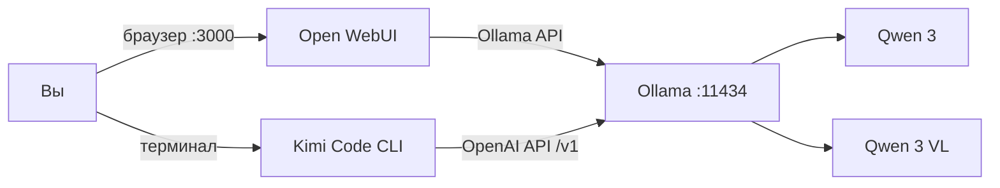

<div align="center">
  

  <p><strong>Локальный AI без облачной обязаловки: чат, зрение и coding agent в одном репозитории.</strong></p>

  <p>
    <a href="https://github.com/media314/BRODYAGA/actions/workflows/validate.yml"></a>
    
    
    
    
    
  </p>
</div>

> **БРОДЯГА** — готовая сборка из [Open WebUI](https://docs.openwebui.com/) и
> [Ollama](https://docs.ollama.com/): интерфейс в стиле ChatGPT, локальные Qwen 3 и
> Qwen 3 VL, плюс [Kimi Code CLI](https://github.com/MoonshotAI/kimi-code), подключённый
> к тем же моделям через OpenAI-совместимый API.

## Что внутри

| Часть | Роль |
|---|---|
| **Open WebUI** | Красивый браузерный чат, история, файлы, изображения, RAG и несколько пользователей |
| **Ollama** | Локально скачивает и запускает модели, отдаёт native и OpenAI-compatible API |
| **Qwen 3** | Основная текстовая LLM: диалог, reasoning, инструменты и код |
| **Qwen 3 VL** | VLM: изображения, скриншоты, OCR и визуальный разбор |
| **Kimi Code CLI** | Coding agent в терминале: читает и меняет проект, запускает команды и использует локальный Qwen |



По умолчанию сервисы доступны **только на `127.0.0.1`**. Чаты и модели остаются
в Docker volumes, а внешние API-ключи для локального режима не нужны.

## Быстрый старт

Нужны Git и Docker с Compose. Для NVIDIA GPU сначала выполните
[инструкцию по драйверу и NVIDIA Container Toolkit](docs/cuda.md).

```bash
git clone https://github.com/media314/BRODYAGA.git
cd BRODYAGA

# Linux + NVIDIA GPU
./scripts/bootstrap.sh --gpu
```

Когда загрузка моделей закончится, откройте **http://localhost:3000** и создайте
первую учётную запись — она станет администратором.

Другие режимы:

```bash
./scripts/bootstrap.sh --cpu       # любой компьютер, медленнее
./scripts/bootstrap.sh --native    # Ollama уже работает на хосте; лучший вариант для macOS/Windows
./scripts/bootstrap.sh --gpu --light  # модели 4B для слабой машины
```

Стандартный профиль скачивает `qwen3:8b` и `qwen3-vl:8b` (примерно 11.3 ГБ
весов суммарно). Профиль `--light` — две модели 4B (примерно 5.8 ГБ).

## Kimi Code + локальные модели

```bash
./scripts/install-kimi.sh       # официальный установщик Moonshot AI
./scripts/kimi-local.sh .       # Kimi Code + локальный qwen3:8b
```

Скрипт использует изолированный конфиг в `.runtime/kimi`, не трогает ваш
`~/.kimi-code/config.toml` и запускает агента в ручном режиме подтверждений.
Выбрать VLM или другую модель:

```bash
./scripts/kimi-local.sh --model qwen3-vl:8b .
./scripts/kimi-local.sh --model qwen3:30b /path/to/project
```

Для официальной облачной модели Kimi запустите `kimi`, затем `/login`. Все варианты
подключения, включая ручной TOML, описаны в [docs/kimi.md](docs/kimi.md).

## Команды

```bash
make up             # контейнерный CPU-режим
make up-gpu         # NVIDIA GPU
make up-native      # Open WebUI + Ollama на хосте
make pull           # скачать модели из .env
make doctor         # диагностика системы и сервисов
make test           # статическая проверка проекта
make logs           # логи
make down           # остановить, данные сохранить
```

Настройки находятся в `.env` и документированы в [.env.example](.env.example).
Чтобы поменять модели:

```dotenv
QWEN_MODEL=qwen3:14b
VLM_MODEL=qwen3-vl:8b
```

Затем выполните `make pull`. Подробный выбор модели и реальные требования к
RAM/VRAM — в [docs/models.md](docs/models.md).

## Системные требования

| Профиль | Модели Q4 | RAM | VRAM NVIDIA / Apple unified memory | Диск под стек |
|---|---|---:|---:|---:|
| Лёгкий | Qwen 3 4B + Qwen 3 VL 4B | 16 ГБ | 6–8 ГБ | 15+ ГБ |
| Рекомендуемый | Qwen 3 8B + Qwen 3 VL 8B | 32 ГБ | 10–12 ГБ | 25+ ГБ |
| Мощный | Qwen 3 30B + Qwen 3 VL 30B | 64 ГБ | 24+ ГБ | 55+ ГБ |

Это практические ориентиры для **одной активной модели** и контекста около 32K.
Длинный контекст, параллельные запросы и одновременное удержание двух моделей
требуют больше памяти. Ollama поддерживает NVIDIA с compute capability 5.0+ и
драйвером 531+; точный актуальный список есть в [официальной таблице GPU](https://docs.ollama.com/gpu).

## Про «без цензуры»

В БРОДЯГЕ нет отдельного moderation-сервиса и нет добавленного системного промпта,
который фильтрует ответы. Всё выполняется локально. При этом репозиторий не может
гарантировать «полную бесцензурность»: поведение определяется весами выбранной
модели, её лицензией и вашим системным промптом. Владелец инсталляции отвечает за
законное и безопасное использование.

## Документация

- [CUDA, NVIDIA driver и Container Toolkit](docs/cuda.md)
- [Модели, память и профили](docs/models.md)
- [Kimi Code: установка и подключения](docs/kimi.md)
- [Диагностика и частые проблемы](docs/troubleshooting.md)
- [Официальные первичные источники](docs/references.md)

## Безопасность и обновления

- Порты привязаны к loopback; не меняйте `*_BIND` на `0.0.0.0` без reverse proxy,
  TLS и продуманной аутентификации.
- Не коммитьте `.env`, `.runtime/` или API-ключи — они уже в `.gitignore`.
- Образы закреплены на проверенных версиях в `.env.example`; обновляйте их
  осознанно и запускайте `make test` после изменений.
- `make down` сохраняет данные. Удаление volumes намеренно не автоматизировано.

## Лицензия

Код и документация этого репозитория — [MIT](LICENSE). Open WebUI, Ollama, Qwen и
Kimi Code распространяются на условиях собственных лицензий; перед публичным или
коммерческим развёртыванием проверьте их отдельно.

<div align="center">
  <sub>Собрано для тех, кому нужен свой AI — на своей машине и со своими правилами.</sub>
</div>
